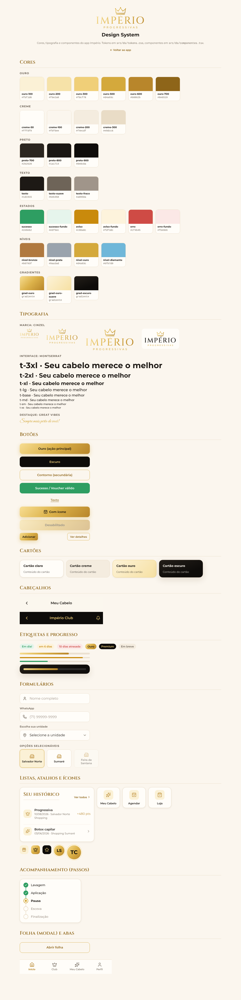

# Império Design System

Guia visual do app Império Progressivas, baseado na [referência visual](referencia-visual.png).
Para ver tudo funcionando, abra o app com **`#design-system`** no fim do endereço ou toque em **Perfil → Design system**.

## Versão 6 (atual): "Suave", inspirada no app Flo
Referência escolhida pela Império: a linguagem visual do app Flo. Adotamos o estilo, sem copiar a marca, o logotipo ou as ilustrações deles.

| Elemento | Padrão |
|---|---|
| Fundo | Off-white quente `#F8F4F3`; cada assunto ganha um tom pastel: rosa bebê `#FBE6EA` (agenda, manutenção), azul bebê `#E6F0F8` (cabelo, diagnóstico), lavanda `#EFE8F6` (Club, conteúdos), areia `#F2ECE8` (loja, perfil) |
| Ação | Rosa Império `#C4466B` em botões pílula (texto branco, contraste 4,8:1) |
| Club | Dourado `#B48A3C` em detalhes de fidelidade |
| Assinatura visual | **Título com marca-texto**: uma linha curta em sans + a palavra principal em serifada grande sobre um bloco pastel (`TituloDestaque`) |
| Tipografia | Newsreader (serifada editorial) nos destaques e números; fonte do sistema (SF Pro no iPhone) com Figtree como alternativa na interface |
| Forma | Cartões brancos com raio 22 a 32, sombra suave; ícones em círculo; selecionado com contorno rosa e selo ✓ |
| Início | "Hoje" no topo: a semana com o dia ideal da manutenção em círculo tracejado, a frase grande ("33 dias atrasada", "em 6 dias") e o botão em pílula, como o "Menstruação em 2 dias" do Flo |
| Conteúdo do dia | Cartões com cabeçalho pastel e borda colorida |

### Ícones próprios (v6.1)
Os ícones de biblioteca (traço genérico) deram lugar a um conjunto desenhado para a Império, em `src/ds/ilustras.tsx`:
- **Ilustrados** (`Il*`, 48×48): objeto em duas cores (rosa Império, dourado e traço tinta) sobre uma forma orgânica pastel. As três formas se alternam para os ícones não ficarem iguais. Usados em atalhos, listas, recompensas, serviços e Cuidados.
- **Abas** (`Aba*`, 24×24): traço arredondado; a aba ativa ganha preenchimento rosa bebê.
- Os componentes `Atalho`, `ItemLista` e `IconeMoldura` aceitam os dois tipos; um ícone ilustrado dispensa a moldura.
- Os ícones de biblioteca ficam só em ações pequenas dentro de botões e campos (seta, sino, cadeado).

## Versão 5 (atual): "Noite & Champanhe"
Definida com um especialista em UX a partir da imagem de referência da Império.

**Princípios:** o ônix é estrutura (topo das telas, barra de abas, cartão do Club) e não decoração; o corpo é marfim; o dourado champanhe aparece só em ação (botão principal) e valor (pontos, nível); o rosa é detalhe (no máximo um cartão rosa por tela); a fotografia é protagonista.

**Assinatura: o Fio de Ouro.** Um filete de 1 px em gradiente champanhe que separa o topo ônix do corpo marfim e contorna o cartão do Império Club.

| Token | Hex | Uso |
|---|---|---|
| Marfim | `#FAF6EF` | fundo |
| Branco / Areia | `#FFFFFF` / `#F3EADF` | cartões / campos, chips, segmentado |
| Ônix | `#16110F` (`#241C1A`, `#362B28`) | topos, barra de abas, Club |
| Ouro champanhe | `#D4B47E` (gradiente `#E2C895 → #C9A46A`) | botão principal, progresso |
| Ouro tinta / noite | `#8A6630` / `#D9BC85` | dourado como texto no claro / no escuro |
| Rosa / acento / tinta | `#F7E4E6` / `#E8B9C2` / `#93465A` | cartão especial, ponto da aba ativa, texto no rosa |
| Texto | `#1C1517`, `#5F5457`, `#7A6E70` | primário, secundário, legenda |

Contrastes (WCAG): ônix sobre ouro 9,5; ouro-tinta sobre marfim 4,8; texto sobre marfim 16,7; texto-noite sobre ônix 16,4; rosa-tinta sobre rosa 5,3.

**Tipografia:** Noto Serif Display (marca, títulos grandes, pontos, nível em itálico) e Hanken Grotesk (interface). Sobretítulos em caixa alta 11 px espaçados; botões em frase.

**Forma:** botões em pílula de 52 px; cartões com raio 16 e borda fina; Club e folhas com raio 24; horários em pílulas de areia (selecionado em ônix); datas com número serifado; barra de abas ônix com dourado e ponto rosa na aba ativa. Enquanto a foto carrega, o espaço fica em areia com brilho suave, nunca em bloco marrom.

## Refinamento 5.1 (pesquisa de referências)
Ajustes a partir de referências de design de luxo, de agendamento de salão e de programas de fidelidade:
- **Contenção:** só os pesos 400 e 500; hierarquia por tamanho e espaçamento entre letras. Títulos de seção na serifada. Referência: o design system da Aman, em que todos os pesos são 400 e a hierarquia vem do tamanho e do espaçamento.
- **Cantos retos:** raio de 2 a 10 px, em vez de pílulas. Botões retangulares em caixa alta espaçada, como em marcas de moda.
- **Respiro:** margem lateral de 24 px e 32 px entre blocos.
- **Agendamento:** só aparecem horários livres, agrupados em Manhã, Tarde e Noite. A grade de horários riscados saiu.
- **Fidelidade:** o cartão mostra o saldo e a próxima recompensa ("faltam X pts para…"). Cada nível tem um cartão próprio: Bronze, Prata, Ouro e Diamante (perolado).
- **Fotografia:** as referências de luxo só funcionam com boa fotografia; as 12 fotos da Higgsfield precisam entrar no app.

## Movimento (biblioteca Motion)
Biblioteca: [Motion](https://motion.dev) (`motion`, antiga Framer Motion). Todo movimento respeita a opção do celular de reduzir animações (`MotionConfig reducedMotion="user"`).

| Onde | Movimento | Por quê |
|---|---|---|
| Boas-vindas | Foto com leve aproximação (2,4 s) e entrada em sequência de logo, frase e botões | O único momento coreografado do app |
| Troca de tela | Esmaecer e subir 10 px (220 ms) | Continuidade sem chamar atenção |
| Folha inferior | Sobe com mola; fecha ao arrastar para baixo | Gesto nativo de celular |
| Barra de abas | Traço dourado desliza até a aba ativa; ícone encolhe ao toque | Mostra para onde a cliente foi |
| Controle segmentado | Pílula desliza entre as opções | Mostra o que mudou |
| Pontos do Club | Número conta até o saldo quando aparece | Valoriza a conquista |
| Avisos (toast) | Entram com mola e saem esmaecendo | Feedback sem susto |

Regra: movimento só responde a uma ação da cliente ou marca uma conquista; nada de animação decorativa em cada cartão.

## Princípios
1. **Luxo acolhedor**: fundo creme, detalhes em ouro e preto só para dar contraste e destaque.
2. **O ouro é para ação**: o gradiente ouro marca a ação principal de cada tela. Use um botão ouro por tela.
3. **Clareza para a cliente**: textos curtos, status com cor e palavra ("Em dia!", "em 6 dias") e ícones de linha.

## Tokens (`src/ds/tokens.css`)
| Grupo | Tokens | Uso |
|---|---|---|
| Ouro | `--ouro-100` … `--ouro-700` | Marca, ícones, links, destaques |
| Creme | `--creme-50` … `--creme-300` | Fundos, cartões e bordas |
| Preto | `--preto-700` … `--preto-900` | Cabeçalhos escuros, splash, contraste |
| Texto | `--texto`, `--texto-suave`, `--texto-fraco` | Hierarquia de leitura |
| Estados | `--sucesso`, `--aviso`, `--erro` (+ `-fundo`) | Status de manutenção e validação |
| Níveis | `--nivel-bronze/prata/ouro/diamante` | Império Club |
| Gradientes | `--grad-ouro`, `--grad-ouro-suave`, `--grad-escuro` | Botão principal, cartão do Club, topo escuro |
| Espaço | `--e-1` (4px) … `--e-8` (32px) | Sempre múltiplos de 4 |
| Raio | `--r-sm` 8 · `--r-md` 12 · `--r-lg` 16 · `--r-xl` 24 · `--r-pill` | Botões 12, cartões 16, folhas 24 |
| Sombra | `--sombra-1`, `--sombra-2`, `--sombra-ouro` | Cartões, folhas, botão ouro |

## Tipografia
| Papel | Fonte | Onde |
|---|---|---|
| Marca | **Cinzel** | Logotipo, nome do nível ("PRATA"), números de destaque |
| Interface | **Montserrat** 400–700 | Todo o resto |
| Assinatura | **Great Vibes** | Frases afetivas ("Sempre mais perto de você!"), com moderação |

Escala: `--t-xs` 11 · `sm` 12 · `md` 14 · `base` 16 · `lg` 18 · `xl` 22 · `2xl` 28 · `3xl` 36.

## Componentes (`src/ds/componentes.tsx`)
| Componente | Para quê |
|---|---|
| `Marca` | Logo Império (sm/md/lg, ouro ou escuro) |
| `Botao` / `BotaoLink` | Variantes `ouro`, `escuro`, `contorno`, `sucesso`, `texto`; tamanhos `md`/`sm` |
| `Cartao` | Tons `claro`, `creme`, `ouro`, `escuro`; vira botão quando recebe `onClick` |
| `Cabecalho` | Topo de tela com voltar (claro ou escuro) |
| `TituloSecao` | Título com link "Ver todos" |
| `Etiqueta` | Status: `sucesso`, `aviso`, `erro`, `ouro`, `escuro`, `neutro` |
| `Progresso` | Barra de nível e de manutenção |
| `Campo` / `Selecao` | Formulários com ícone |
| `Opcao` | Tile selecionável (unidade, plano, horário) |
| `ItemLista` | Linhas de histórico e menus |
| `Atalho` | Ícone + rótulo da tela inicial |
| `IconeMoldura` | Ícone em quadrado creme, ouro ou escuro |
| `Passos` | Acompanhamento do procedimento ao vivo |
| `Avatar` | Iniciais da cliente |
| `Folha` | Modal que sobe de baixo (confirmações) |
| `BarraAbas` | Navegação inferior |

Ícones: [Lucide](https://lucide.dev) com traço 1.75. Mapas por serviço e recompensa ficam em `src/ds/icones.ts`.

## Regras rápidas
- Fundo da tela: `--creme-100`. Cartões: `Cartao tom="claro"`.
- Telas "premium" (Club, assinatura, pagamento) usam `Cabecalho tom="escuro"`.
- Não use cores soltas no código: use sempre um token.
- Alvo de toque com no mínimo 44px. Os botões têm 48px.
